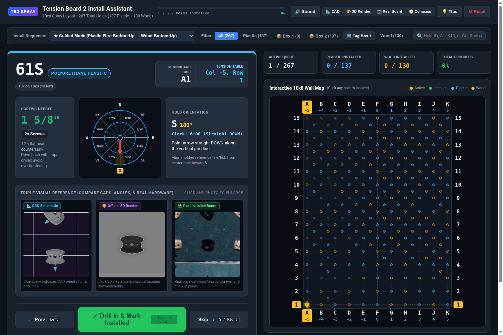
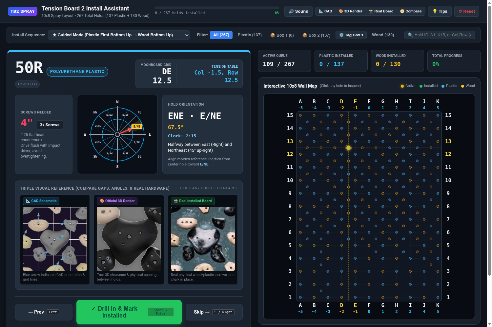
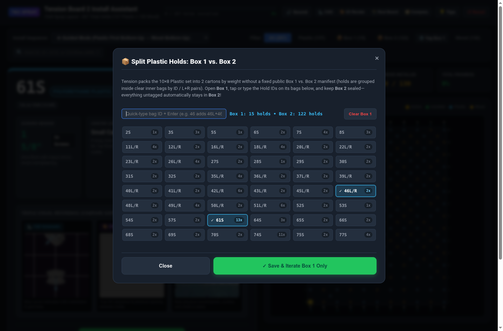

# 🧗 Tension Board 2 (TB2) — Interactive Hold Installation Assistant

An interactive, step-by-step web app for installing holds on a **10×8 Tension Board 2 (Spray Layout)** — built so you can stand at the wall with an impact driver, tap `Space` as you drill each hold in, and never mis-orient a wood arrow, grab the wrong screw length, or lose your place across the 6-page PDF table.



---

## ✨ What It Solves

Installing 267 screw-on holds (609 screws total) from the static PDF guide + web table has a few classic pain points:
1. **Plastic First ("Set-by-Set") vs. Unlabeled Shipping Cartons**: Tension recommends installing all **137 plastic holds** first (as visual landmarks) before the **130 wood holds**, and packs the 10×8 plastic holds into **2 heavy shipping cartons** split across 48 inner poly bags without a Box 1 vs. Box 2 packing list.
2. **16-Point Nautical Compass & Wood Arrow Rule**: Half-wind headings like `E/NE (67.5°)` or `W/SW (247.5°)` are easy to eyeball wrong, and **wood holds must be oriented by their stamped arrow/SKU (perpendicular to the screw holes), NOT their usable grip edge**.
3. **CAD vs. Physical Clearances**: The PDF's CAD schematic doesn't always reflect true 3D spacing or wood grain appearance—seeing the **CAD diagram**, **official 5000px 3D render**, and a **perspective-rectified real installed board photo** side-by-side makes rotation checks instantaneous.
4. **Coordinate Translation**: Shows both **MoonBoard-style grid coordinates** (`A1..K15`, plus half-grid letters like `DE 12.5`) and **Tension's Hold Details Table coordinates** (`Col -5..+5, Row 1..15`) on every card and on the interactive wall map.

---

## 📸 Screenshots

### Half-Wind Hold (`50R` at `DE 12.5` / `Col -1.5, Row 12.5`) with Full-Size 16-Point Compass & Crosshairs


### `📦 Box 1` vs. `📦 Box 2` Plastic Bag Splitter
Open **Box 1**, leave **Box 2** sealed, and tap or quick-type the ~20 bag IDs in Box 1 (`L/R` pairs toggle in one click). The app immediately filters your queue to **Box 1 Only**, and assigns the rest to **Box 2**:


---

## 🚀 Quick Start

Zero dependencies (pure HTML/CSS/JS + Python standard library):

```bash
python3 server.py
```

Then open **http://localhost:8844** in your browser (or serve the `static/` directory directly via **GitHub Pages** / any static file host). Progress is saved automatically in `localStorage`.

### Keyboard Shortcuts (Hands-Free at the Wall)
- `Space` / `Enter`: Mark current hold installed (plays chime & advances to next uninstalled hold)
- `→` / `S`: Skip to next hold
- `←`: Previous hold
- `U`: Undo / toggle installed status
- `/` or `F`: Focus quick search (search by Hold ID like `46R`, MoonBoard grid like `DE 12.5`, or Tension `Col,Row` like `-1.5,12.5`)

---

## 🤖 Adapting to **10×8 Mirror** or Other Board Sizes (`12×8`, `12×10`, `12×12`)

This repository is pre-configured for the **10×8 Spray Layout** (267 holds: 137 Plastic + 130 Wood), without LEDs.

If you are installing the **Mirror Layout** or a larger board size (**12×8**, **12×10**, or **12×12**), you can hand this repo to any AI coding agent along with Tension's public installation resources and ask it to regenerate `static/data/holds.json` and the cropped reference images:

> **Example Prompt for Your AI Coding Agent:**
> *"Adapt this TB2 Install Assistant repo from `10x8 Spray` to `[10x8 Mirror / 12x10 Spray / 12x12 Mirror]`. Here is Tension's Installation Guide PDF for my layout, the link to Tension's interactive Hold Details Table (`https://tensionclimbing.com/...`), and Tension's high-res 3D layout render PNG. Update `static/data/holds.json`, regenerate the per-hold crops in `static/crops*`, and update the SVG grid bounds in `static/app.js`."*

Want the **Center Light Cap / 1.5" Acrylic LED Extension Pipe** callouts back on the hold card? Each hold entry in `static/data/holds.json` already includes `"light_cap"` (`"Small"` or `"Large"`) and `"needs_pipe"` (`true` on `46L`, `46R`, and `64S`)—just ask your agent to display those fields in `renderHoldCard()`.

---

## 🙏 Credits & Disclaimer

- Hold specifications, compass conventions, CAD schematics, and 3D renders are property of **[Tension Climbing](https://tensionclimbing.com/)**.
- *Disclaimer: This is an unofficial personal community project and is not affiliated with or endorsed by Tension Climbing or my employer.*
